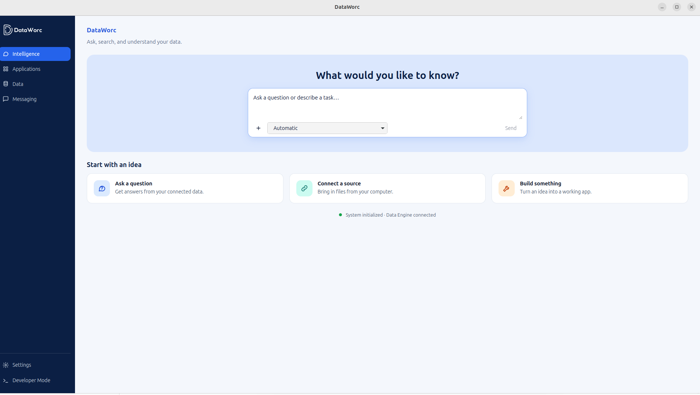
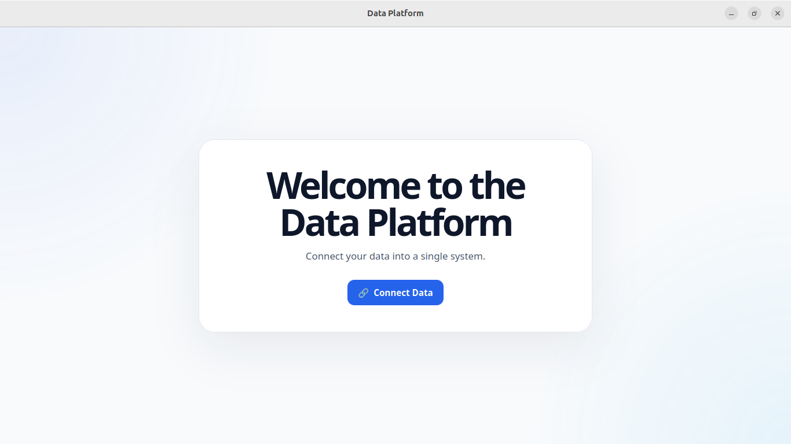
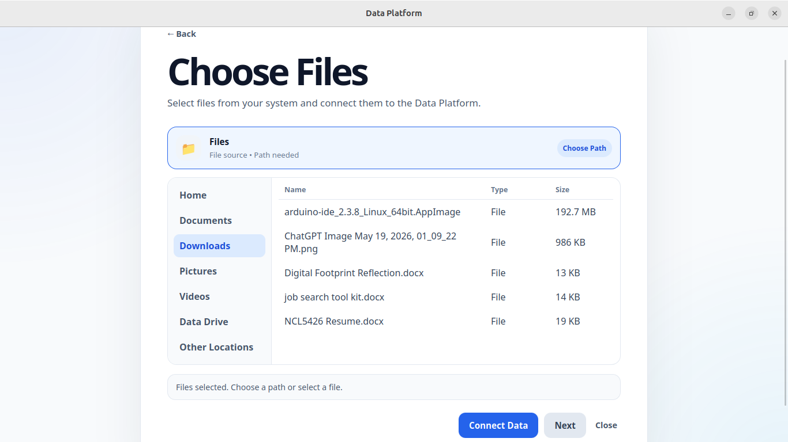
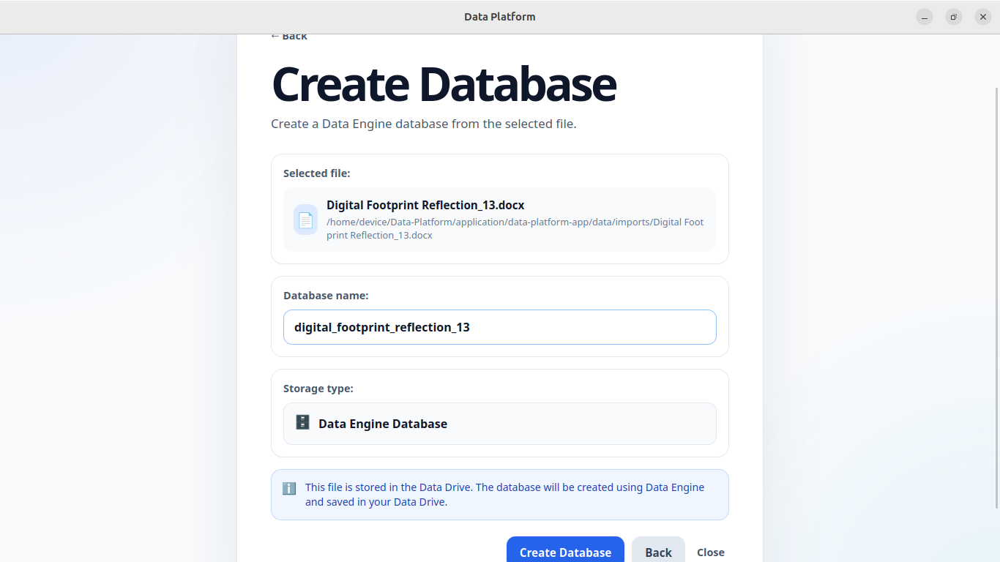
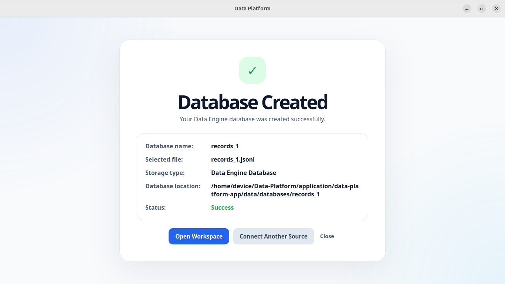
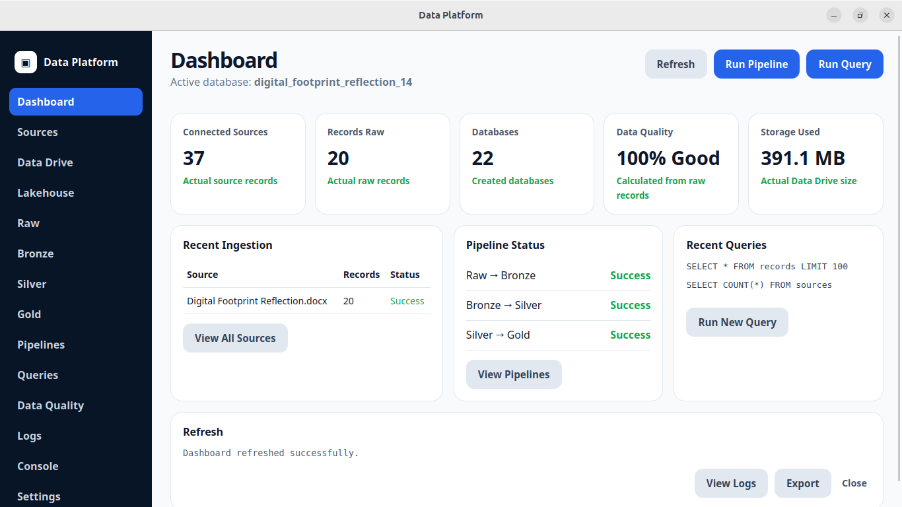

# DataWorc

DataWorc is a full-stack data platform for collecting, processing, storing, querying, and visualizing structured data from systems, devices, APIs, cloud services, and external sources.

The project combines a Python Data Engine with a desktop application built using React, TypeScript, Vite, Rust, and Tauri.

## DataWorc UI 1.1 — Desktop Interface

The updated DataWorc desktop interface brings intelligence,
application development, data management, and messaging into
one workspace.



### Intelligence

Intelligence is the main workspace for interacting with DataWorc.

The interface includes a request composer for asking questions
and describing tasks, an attachment control, and an Automatic
model selection option.

The goal is to provide a unified entry point for information
retrieval, data analysis, and intelligent task execution.

### Applications

Applications provides access to DataWorc's software creation
and application development workflows.

The interface includes an Applications navigation entry and
a Build something quick action.

Application Generation and Application Engineering are
designed to support requirements, planning, code generation,
testing, and verification. Individual capabilities require
their own runtime verification.

### Data

Data provides access to the platform's data management
capabilities.

The interface includes a Data navigation entry and a
Connect a source quick action.

The Data Engine is the system of record, using the canonical
fields `source`, `category`, `data_type`, `value`, and `unit`.

The interface displays a Data Engine connection status.
Actual backend operations require independent verification.

### Messaging

Messaging appears as a dedicated section in the navigation.

It is intended to bring conversations and communication
into the DataWorc application.

This UI checkpoint documents its navigation entry only.
Messaging functionality, conversations, and authentication
integration will be covered in a subsequent update.

### Settings

Settings provides an entry point for application
configuration and preferences.

### Developer Mode

Developer Mode provides access to development-oriented
workflows separately from the main user experience.

### Interface Verification

- Desktop screenshot visually reviewed and approved.
- Screenshot committed and pushed to GitHub.
- TypeScript and Vite production frontend build passed.
- The native Linux application displayed the updated interface.

This is a verified interface documentation checkpoint,
not a completed production application release.

---

## Current Status

This project is in active development.

The current version includes a working Data Engine foundation and a working desktop user interface foundation.

## Screenshots

### Welcome Screen



### Source Selection



### Database Creation



### Database Created



### Workspace Dashboard



## What the Platform Does

Data Platform is designed to connect data sources, process incoming records, organize storage, support querying, and display results through a workspace interface.

The system is being built to support local system data, device data, file-based data, APIs, cloud sources, and future intelligent processing features.

## Core Components

Python Data Engine

React and TypeScript user interface

Tauri desktop runtime

Rust backend command layer

Local storage and lakehouse-style data organization

Validation, recovery, query, and indexing modules

## Development Direction

The platform is being built with a local-first approach and a modular architecture.

The long-term goal is to create a portable data platform that can collect real data, organize it into structured records, and make it usable through a desktop workspace.

## Run the User Interface

From the application folder:

```bash
cd application/data-platform-app
npm run build
npm run tauri dev
